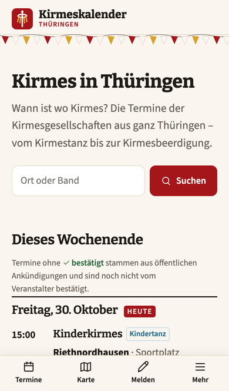
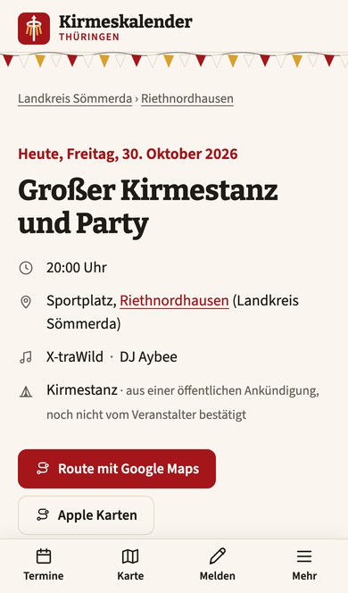
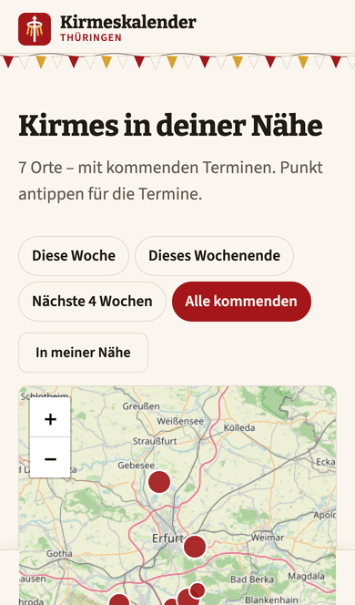

# Kirmeskalender Thüringen

Alle Kirmessen in Thüringen an einem Ort: suchen, nach Landkreis, Ort und Art filtern, aufs Handy
abonnieren – gepflegt von der Redaktion, den Kirmesgesellschaften und allen, die Termine melden.

**Live:** <https://kirmeskalender-thueringen.de>

  
  
  

## Warum es diesen Kalender gibt

Kirmes ist in Thüringen von Ostern bis in den November fast jedes Wochenende irgendwo – aber wann
wo gefeiert wird, steht verstreut in Insta-Storys, WhatsApp-Gruppen, Amtsblättern und auf Plakaten
an der Bushaltestelle. Wer nicht im richtigen Ort wohnt oder der richtigen Gruppe folgt, verpasst
es. Einen früheren Kirmeskalender für die Region gab es, er wurde aber nicht fortgeführt – seitdem
fehlte ein Ort, an dem alle Termine zusammenstehen.

Der Kalender soll diese Lücke schließen:

- **Für Besucher:** auf einen Blick sehen, wo heute und am Wochenende Kirmes ist – mit Uhrzeit,
  Band, Muttizettel-Hinweis und Route direkt zum Festzelt oder Saal, auch aufs Handy abonnierbar.
- **Für Kirmesgesellschaften:** ihre Kirmes kostenlos sichtbar machen und selbst pflegen, statt
  jedes Jahr neu Aushänge zu verteilen – und Gäste aus den Nachbarorten erreichen.
- **Für das Brauchtum:** Kirmes lebt davon, dass Leute kommen. Je leichter sie zu finden ist, desto
  besser für die Vereine, die sie jedes Jahr auf die Beine stellen.

Kostenlos, ohne Werbung, ohne Tracking. Gebaut und betrieben von Ryan Dustin Schällert aus Elleben
im Ilm-Kreis; die Termine kommen von der Redaktion, den Kirmesgesellschaften und allen, die eine
Kirmes melden.

## Was der Kalender kann

**Für Besucher**

- Was heute und am Wochenende los ist – Liste nach Tag und Uhrzeit, Filter nach Zeitraum,
  Landkreis und Art (Kirmestanz, Party/Disco, Kindertanz, Gottesdienst, Frühschoppen, Ständchen)
- „In meiner Nähe“, Karte, Orts- und Landkreisseiten, „Orte A–Z“
- Terminseite mit Programm, Bands und DJs, Plakat / Flyer, Eintritt, Essen & Getränke,
  Muttizettel-Hinweis samt Vorlage und Route direkt zum Festzelt oder Saal
- Kalender-Abo für ganz Thüringen, einen Landkreis oder einen Ort – Änderungen kommen von selbst
- Termine merken, teilen, in den eigenen Kalender übernehmen
- Termin oder Korrektur melden, ohne Anmeldung
- Fürs Handy gebaut – auch als App auf dem Home-Bildschirm

**Für Kirmesgesellschaften und Redaktion**

- Eigener Zugang mit Passkey (Fingerabdruck, Gesicht oder PIN – kein Passwort)
- Kirmesgesellschaften pflegen ihren Ort selbst: Termine, Plätze mit Kartenpunkt, Vereinsprofil,
  eigene Leute einladen; ihre Termine gelten als **bestätigt**
- Ganze Kirmes auf einmal eintragen oder vom Vorjahr übernehmen, Tabellen-Import
- Vorschläge und Korrekturen von Besuchern prüfen, Mitmach-Anfragen annehmen oder ablehnen
- Fertige Wochenbilder für Instagram und WhatsApp-Status, Widget für Vereins- und Gemeindeseiten
- Zugriffszahlen ohne Tracking

## Wie er gebaut ist

Die Entscheidungen sind als Architecture Decision Records festgehalten
([docs/architecture/adr](docs/architecture/adr/)), die Architektur nach arc42
([docs/architecture](docs/architecture/README.md)).

| Baustein       | Technik                                         | Warum                                                                                                                                                                    |
| -------------- | ----------------------------------------------- | ------------------------------------------------------------------------------------------------------------------------------------------------------------------------ |
| Sprache        | TypeScript auf Node.js                          | Eine Sprache für Website, API und Fachlogik, gemeinsame Typen – leicht für Ehrenamtliche ([ADR 001](docs/architecture/adr/001-typescript-in-allen-schichten.md))         |
| Aufbau         | Clean Architecture, Fachlogik als eigenes Paket | Regeln wie „wer darf was“ ohne Datenbank testbar, Frameworks austauschbar ([ADR 002](docs/architecture/adr/002-clean-architecture-mit-framework-freiem-core-paket.md))   |
| Website        | Astro, serverseitig gerendert                   | Eine Seite pro Ort und Termin für Google, kaum JavaScript im Browser, schnell auf dem Handy ([ADR 006](docs/architecture/adr/006-statisches-frontend-astro-json-api.md)) |
| API            | Fastify                                         | Schlank und schnell, jede Anfrage wird gegen ein Schema geprüft                                                                                                          |
| Datenbank      | PostgreSQL mit PostGIS                          | Umkreissuche in echten Metern, Koordinaten wie bei OpenStreetMap ([ADR 005](docs/architecture/adr/005-postgis-geography-point-4326.md))                                  |
| Datenzugriff   | Festes SQL statt ORM                            | Jede Abfrage sichtbar, prüfbar und automatisch auf SQL-Injection scanbar ([ADR 003](docs/architecture/adr/003-kein-orm-statisches-sql-mit-pg.md))                        |
| Anmeldung      | Passkeys (WebAuthn)                             | Kein Passwort, das gestohlen werden kann, keine E-Mail-Adressen gespeichert ([ADR 023](docs/architecture/adr/023-redaktion-nur-mit-passkey-rollen-und-einladungen.md))   |
| Karte und Orte | Leaflet, OpenStreetMap                          | Freie Daten, über 3.000 Thüringer Orte, keine Google-Karte ohne Zustimmung ([ADR 014](docs/architecture/adr/014-ortsverzeichnis-aus-openstreetmap-odbl.md))              |
| E-Mail         | Brevo (SMTP)                                    | EU-Anbieter mit Zustellprotokoll, kein Postfach-Passwort auf dem Server ([ADR 019](docs/architecture/adr/019-meldungen-an-die-redaktion-per-smtp-ueber-brevo.md))        |
| Bilder         | sharp, resvg                                    | Plakate werden verkleinert und von Metadaten wie GPS befreit; Vorschau- und Wochenbilder entstehen ohne Browser auf dem Server                                           |
| Betrieb        | Docker Compose, GitOps auf Hetzner              | Der Server holt sich neue Versionen selbst – kein Zugang von außen nötig                                                                                                 |

## Qualität, Sicherheit, Datenschutz

- Jede Änderung läuft über einen Pull Request mit automatischen Prüfungen: Tests mit
  Mindestabdeckung, die nie sinken darf, Typen und Schichtenregeln, Secret Scanning (TruffleHog),
  Codeanalyse mit eigenen Regeln (Semgrep, [ADR 007](docs/architecture/adr/007-semgrep-statt-codeql-als-sast.md)),
  bekannte Lücken in Bibliotheken (npm audit, OSV-Scanner), Angriffstest gegen die laufende Seite
  (OWASP ZAP). Gemergt wird nur bei grünem **Quality Gate**.
- Updates dürfen Daten und Zugänge nie verändern: Datenbankänderungen sind nur ergänzend, ein
  Update-Test spielt jede neue Version auf einen Bestand mit Testdaten ein.
- Kein Tracking, keine Werbung, nur technisch notwendige Cookies (Schutz der Formulare). Gezählt
  werden nur Seitenaufrufe je Tag – ohne IP-Adresse.
- Sicherheitslücke gefunden? Siehe [SECURITY.md](SECURITY.md).

## Stand und Verfolgen

Online seit Oktober 2026 und in aktiver Entwicklung. Was gerade passiert, steht in den
[Issues](https://github.com/dschaell/kirmes-thueringen/issues) und
[Pull Requests](https://github.com/dschaell/kirmes-thueringen/pulls) – jede Änderung beginnt mit
einem Issue. Eigene Notizen zum Arbeiten am Code: [docs/entwicklung.md](docs/entwicklung.md).

## Rechte

Der Code ist öffentlich, damit man sich das Projekt anschauen und es verfolgen kann. Er steht
**unter keiner freien Lizenz** – alle Rechte vorbehalten; Kopieren, Weiterverwenden oder Nachbauen
nur nach Absprache. Ortsdaten © OpenStreetMap-Mitwirkende (ODbL), siehe
[db/seed/ORTE-LIZENZ.md](db/seed/ORTE-LIZENZ.md).
