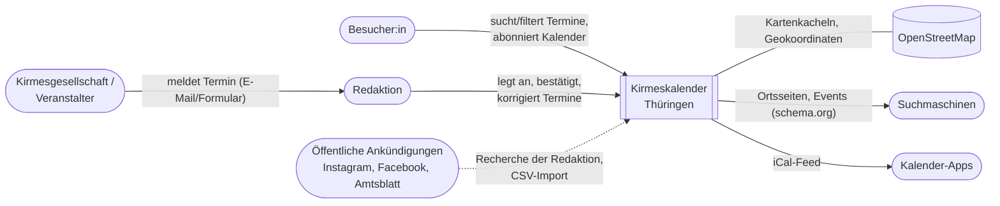

# 3. Kontextabgrenzung

## 3.1 Fachlicher Kontext

Das System ist der zentrale, öffentlich lesbare Kalender für Kirmesveranstaltungen in Thüringen.
Es **verwaltet** Termine, Orte, Landkreise und Veranstalter – es **organisiert keine**
Veranstaltungen und verkauft keine Tickets.

