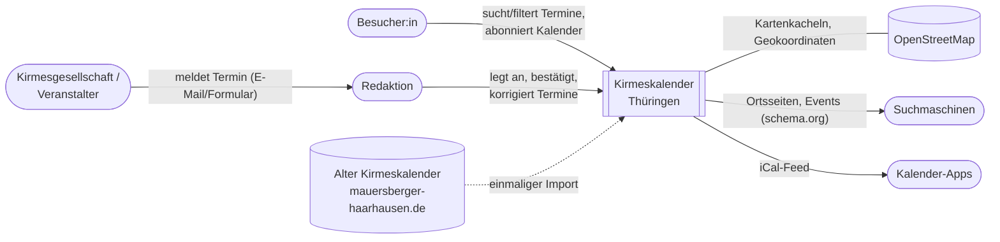
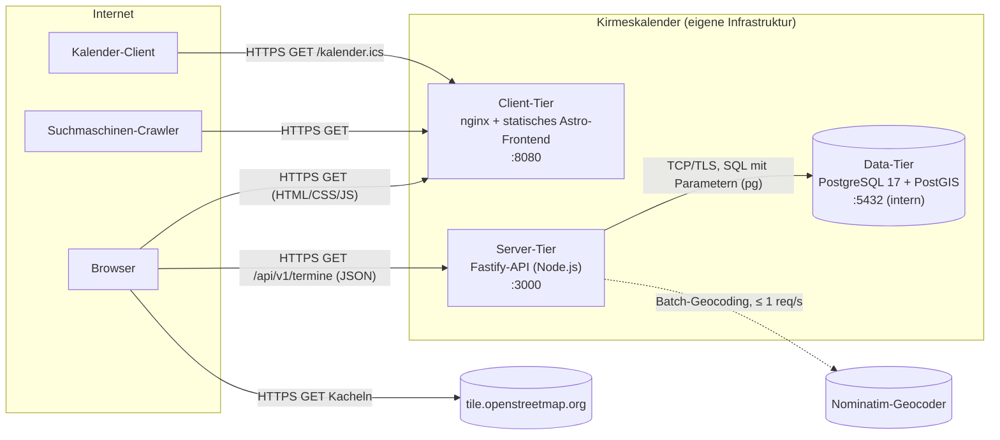

# 3. Kontextabgrenzung

## 3.1 Fachlicher Kontext

Das System ist der zentrale, öffentlich lesbare Kalender für Kirmesveranstaltungen in Thüringen.
Es **verwaltet** Termine, Orte, Landkreise und Veranstalter – es **organisiert keine**
Veranstaltungen und verkauft keine Tickets.

| Kommunikationspartner           | Eingabe an das System                           | Ausgabe des Systems                                                                |
| ------------------------------- | ----------------------------------------------- | ---------------------------------------------------------------------------------- |
| Besucher:in                     | Suchtext, Landkreis(e), Zeitraum, Kategorie     | Terminlisten, Ortsseiten, Karte                                                    |
| Kirmesgesellschaft/Veranstalter | Terminmeldung (Ort, Datum, Uhrzeit, Titel)      | Veröffentlichter Termin, Status „bestätigt“                                        |
| Redaktion                       | Anlegen/Ändern/Bestätigen von Terminen          | Validierungsfehler, fachliche Hinweise (z. B. „Kirmes außerhalb der Herbstsaison“) |
| OpenStreetMap (optional)        | Koordinaten der Orte (Geocoding), Kartenkacheln | Attribution „© OpenStreetMap-Mitwirkende“                                          |
| Suchmaschinen                   | –                                               | HTML mit schema.org-`Event`, Sitemap                                               |
| Kalender-Apps                   | –                                               | `text/calendar` (RFC 5545)                                                         |
| Alter Kirmeskalender            | HTML-Tabelle (einmaliger Import)                | –                                                                                  |

**Fachliche Grenze:** Das System kennt ausschließlich die **23 Thüringer Landkreise und
kreisfreien Städte** (Kfz-Kennzeichen als Schlüssel, `packages/core/src/domain/landkreis.ts`).
Orte außerhalb Thüringens werden bei der Validierung abgewiesen.

## 3.2 Technischer Kontext

| Kanal                 | Protokoll / Format                         | Sicherheit                                                                        |
| --------------------- | ------------------------------------------ | --------------------------------------------------------------------------------- |
| Browser → Web         | HTTPS, HTML/CSS/JS                         | TLS am Reverse-Proxy, CSP ohne `unsafe-inline`, HSTS                              |
| Browser → API         | HTTPS, JSON, RFC 9457 Problem Details      | CORS-Allowlist, Rate-Limit 120/min/IP, Helmet-Header                              |
| API → PostgreSQL      | PostgreSQL-Wire-Protokoll (TLS in Prod)    | nur internes Netz, eigener DB-User mit Minimalrechten, parametrisierte Statements |
| Browser → OSM-Kacheln | HTTPS, PNG                                 | Nur Lesezugriff, keine Nutzerdaten; CSP `img-src` wird dafür erweitert            |
| API → Nominatim       | HTTPS, JSON (nur Batch, nicht pro Request) | Ergebnis wird in `ort.lage` gespeichert, keine Laufzeitabhängigkeit               |

**Technische Grenze:** Die Datenbank ist nie direkt von außen erreichbar. OpenStreetMap ist
**optional**: Fällt OSM aus, funktionieren Suche, Listen und Ortsseiten weiter; nur die Karte
bleibt leer (siehe [Kapitel 8.3](08-querschnittliche-konzepte.md#83-fehlerbehandlung-und-resilienz)).
