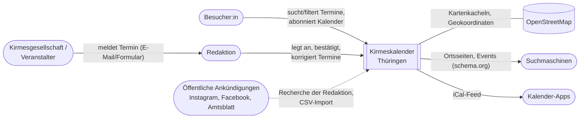
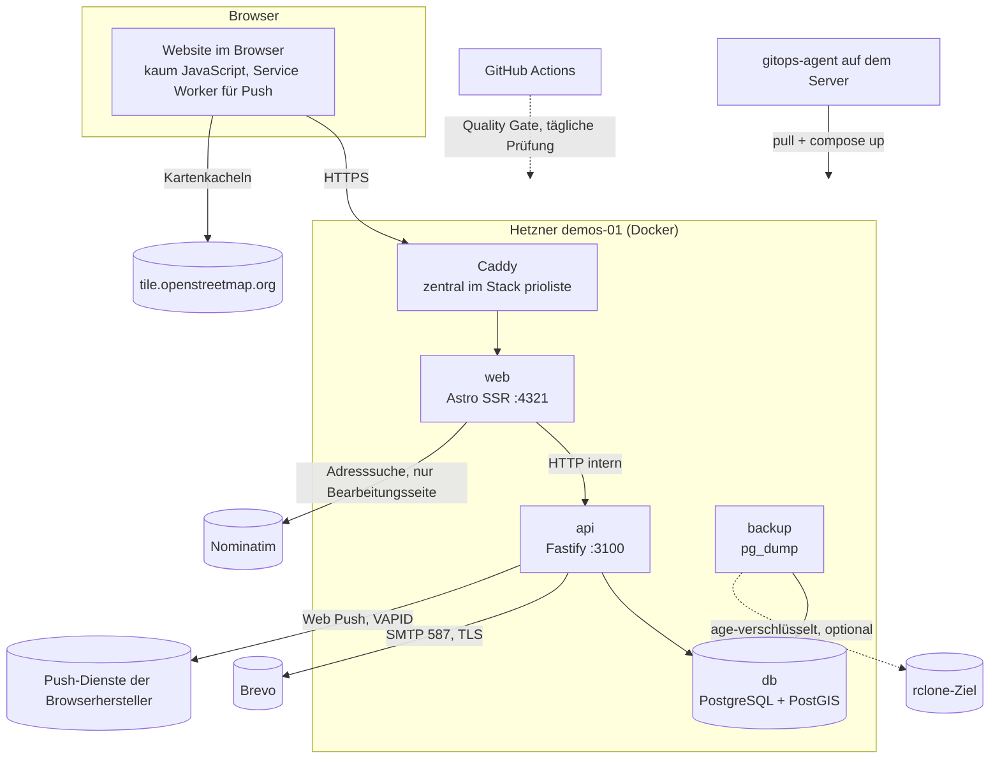

# 3. Kontextabgrenzung

## 3.1 Fachlicher Kontext

Das System ist der zentrale, öffentlich lesbare Kalender für Kirmesveranstaltungen in Thüringen.
Es **verwaltet** Termine, Orte, Landkreise und Veranstalter – es **organisiert keine**
Veranstaltungen und verkauft keine Tickets.

**OpenStreetMap (aktiv):** Das Ortsverzeichnis (3.076 Orte mit Koordinaten) stammt aus einem
einmaligen Batch-Abruf über die Overpass-API (`scripts/ortsverzeichnis.mjs`) – im Betrieb gibt es
**kein Geocoding im Request-Pfad**. Der Browser lädt Kartenkacheln von `tile.openstreetmap.org` nur
auf `/karte` und der Bearbeitungsseite; die Adresssuche (Nominatim) nur auf der Bearbeitungsseite.

## 3.2 Technischer Kontext

| Partner                          | Protokoll / Richtung                    | Inhalt                                                                                                                  |
| -------------------------------- | --------------------------------------- | ----------------------------------------------------------------------------------------------------------------------- |
| Browser                          | HTTPS → Caddy → `web`                   | Seiten, Formulare (GET-Suche, POST-Meldungen), Kalender-Feed, Sitemap                                                   |
| `web` → `api`                    | HTTP im internen Docker-Netz            | Alle Daten; die API ist nie öffentlich (Website als einziger Client)                                                    |
| `api` → PostgreSQL               | TCP 5432, `pg`-Pool, Rolle `kirmes_app` | Daten lesen und schreiben, kein DDL                                                                                     |
| `migrate` → PostgreSQL           | TCP 5432, Rolle `kirmes` (Owner)        | Migrationen und Anlegen der API-Rolle                                                                                   |
| `api` → Brevo                    | SMTP, Port 587 mit TLS                  | Meldungen und Einladungen per E-Mail; ohne Konfiguration nutzt das Formular `mailto`                                    |
| `api` → Push-Dienste             | Web Push mit VAPID                      | Benachrichtigungen an freiwillig angemeldete Browser; ohne Schlüsselpaar ist Push aus                                   |
| Browser → OpenStreetMap          | HTTPS                                   | Kartenkacheln nur auf `/karte` und der Bearbeitungsseite (eigene CSP je Seite)                                          |
| Server → Overpass (Einmalabruf)  | HTTPS, Batch                            | Ortsverzeichnis (`scripts/ortsverzeichnis.mjs`), nie im Request-Pfad                                                    |
| `backup` → Ziel außen (optional) | rclone, Dateien mit `age` verschlüsselt | Offsite-Kopie der Dumps, aus bis ein Ziel konfiguriert ist                                                              |
| GitHub Actions                   | HTTPS                                   | Quality Gate bei jedem PR, tägliche Inhaltsprüfung (Lighthouse, SEO), Erreichbarkeitsprüfung                            |
| `gitops-agent`                   | Git über HTTPS, alle 2 Minuten          | Holt Code und verschlüsselte Secrets, startet den Stack neu (siehe [Betrieb auf Hetzner](../betrieb/hetzner-gitops.md)) |

### Öffentliche Schnittstellen der Website

| Pfad                                                                                   | Zweck                                    |
| -------------------------------------------------------------------------------------- | ---------------------------------------- |
| `/`, `/termine`, `/orte/<ort>`, `/kreise/<kreis>`, `/termin/<id>`, `/karte`            | Seiten für Besucher und Suchmaschinen    |
| `/kalender.ics`                                                                        | iCal-Feed (gesamt, je Landkreis, je Ort) |
| `/sitemap.xml`                                                                         | Sitemap mit allen Orts- und Terminseiten |
| `/orte-suche.json`, `/suche-vorschlaege.json`, `/adresssuche.json`, `/mitteilung.json` | JSON-Endpunkte für die Seiten            |
| `/wochenbild.png`, `/einbetten/…`                                                      | Wochenbild und einbettbares Widget       |
| `/termin-melden`, `/beitrag-melden`, `/redaktion-mitmachen`                            | Formulare ohne Anmeldung                 |
| `/admin/…`                                                                             | Redaktion (Passkey-Anmeldung, `noindex`) |

Die API (`/api/v1/…`, `/health/live`, `/health/ready`) ist nur im internen Netz erreichbar; Details in [5.2](05-bausteinsicht.md).
