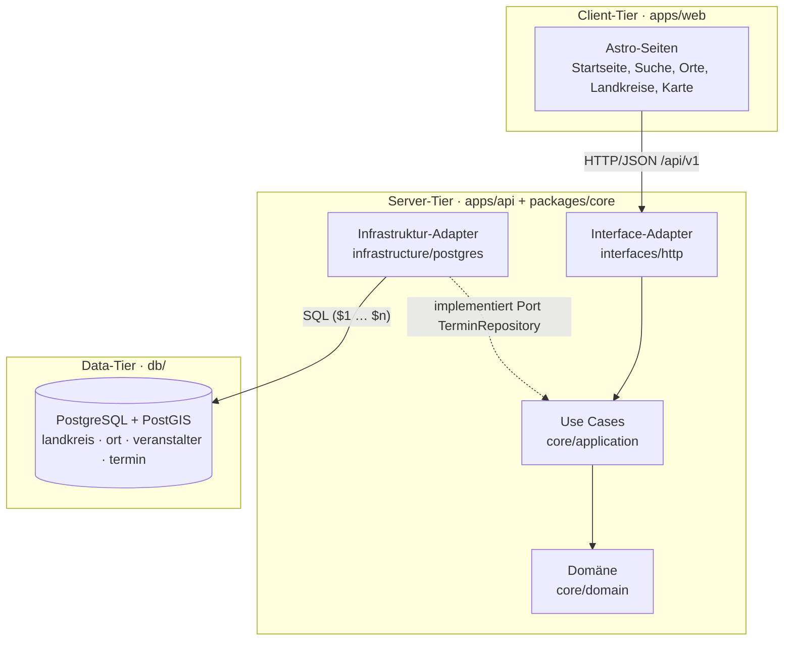
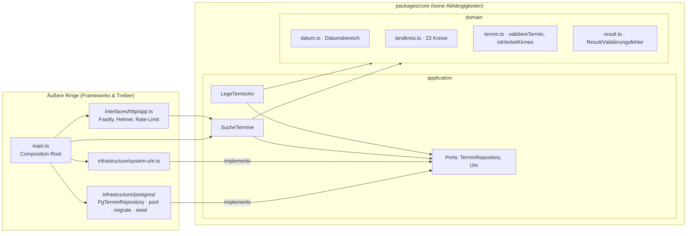
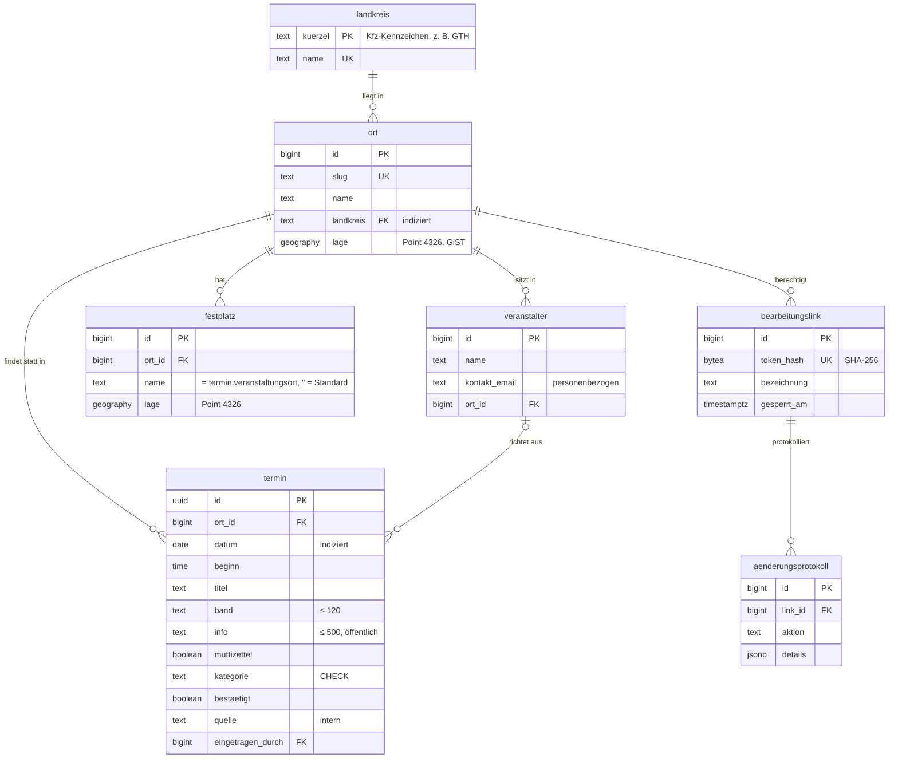

# 5. Bausteinsicht

## 5.1 Ebene 1 – N-Tier-Gesamtsystem



| Baustein        | Verantwortung                                                     | Code                       |
| --------------- | ----------------------------------------------------------------- | -------------------------- |
| Kirmes-Frontend | Darstellung, Suche/Filter im Browser, Ortsseiten, Karte, iCal     | `apps/web`                 |
| Core-Logik      | Fachregeln (Landkreise, Datumsbereiche, Saison), Use Cases, Ports | `packages/core`            |
| API-Server      | HTTP-Schnittstelle, Komposition, PostgreSQL-Adapter, Migrationen  | `apps/api`                 |
| Persistenz      | Schema, Indizes, Constraints, Migrationen, Seed                   | `db/migrations`, `db/seed` |

## 5.2 Ebene 2 – Server-Tier nach Clean Architecture



**Abhängigkeitsregel:** Pfeile zeigen nur nach innen. Erzwungen durch
[`.dependency-cruiser.cjs`](../../.dependency-cruiser.cjs) und ESLint (`no-restricted-imports`):

| Regel                          | Bedeutung                                                            |
| ------------------------------ | -------------------------------------------------------------------- |
| `domain-ist-rein`              | `core/domain` importiert weder `application` noch `apps/*`           |
| `core-ohne-frameworks`         | `packages/core` importiert keine npm-Pakete und keine `node:`-Module |
| `http-nicht-direkt-auf-db`     | HTTP-Adapter kennt weder `pg` noch `infrastructure/*`                |
| `infrastruktur-nicht-auf-http` | Persistenz-Adapter kennt keine HTTP-Details                          |
| `keine-zyklen`                 | Keine zirkulären Abhängigkeiten                                      |

### Schnittstellen (Ports) des Core

```ts
interface TerminRepository {
  // Driven Port → PostgreSQL-Adapter
  suche(filter: TerminFilter): Promise<Seite<Termin>>;
  speichere(termin: NeuerTermin): Promise<Termin>;
}
interface Uhr {
  heute(): KalenderDatum;
} // Driven Port → SystemUhr (Europe/Berlin)

class SucheTermine {
  ausfuehren(a: SucheAnfrage): Promise<Result<Seite<Termin>, Validierungsfehler[]>>;
}
class LegeTerminAn {
  ausfuehren(e: TerminEingabe): Promise<Result<{ termin; hinweise }, Validierungsfehler[]>>;
}
```

#### Zugriffsschutz (Ports)

Schreibende Use Cases bekommen den **Akteur** als Parameter und prüfen Rechte über Ports – der Core
kennt weder Cookies noch HTTP-Header:

| Akteur             | Nachweis                                        | Port(s) im Core                                                    | Darf                                      |
| ------------------ | ----------------------------------------------- | ------------------------------------------------------------------ | ----------------------------------------- |
| Kirmesgesellschaft | persönlicher Bearbeitungslink (Token, nur Hash) | `Bearbeitungslinks.pruefe(token) → Berechtigung`                   | Termine und Festplätze **ihres** Ortes    |
| Redaktion (Admin)  | Sitzung nach Passwort + TOTP oder Passkey       | `AdminKonten`, `Kryptografie`, `Sitzungen`, `Passkeys`, `WebAuthn` | alles: Orte, Termine, Mitteilungen, Links |
| Besucher           | –                                               | –                                                                  | lesen, Meldung an die Redaktion senden    |

`Berechtigung` (Ort, Link- bzw. Admin-ID) fließt bis in die Persistenz: Jede Schreibanweisung prüft
im `WHERE` den Ort und schreibt einen Eintrag ins `aenderungsprotokoll` (wer, was, wann).

`TerminFilter` ist bereits validiert (Datumsbereich ≤ 366 Tage, nur Thüringer Landkreise,
Limit 1–200) und enthält keine SQL- oder HTTP-Konzepte. Technische Fehler der Persistenz
werden als `PersistenzNichtVerfuegbar` gemeldet – der Core kennt keinen Treiberfehler.

### HTTP-Schnittstelle (v1)

| Methode & Pfad                                  | Beschreibung                                                                                                            | Antworten                            |
| ----------------------------------------------- | ----------------------------------------------------------------------------------------------------------------------- | ------------------------------------ |
| `GET /api/v1/termine`                           | Suche: `von`, `bis`, `landkreis`, `kategorie`, `q`, `bestaetigt`, `limit`, `offset`                                     | 200 JSON · 400 Problem Details · 503 |
| `GET /api/v1/landkreise`                        | Alle 23 Landkreise                                                                                                      | 200                                  |
| `GET /api/v1/orte`                              | Alle Orte mit Anzahl kommender Termine                                                                                  | 200                                  |
| `GET /api/v1/orte/:slug`                        | Ein Ort                                                                                                                 | 200 · 404                            |
| `GET /api/v1/termine/:id`                       | Ein Termin (teilbare Terminseite)                                                                                       | 200 · 404                            |
| `GET/PUT/DELETE /api/v1/verwaltung/festplaetze` | Festplätze des eigenen Ortes (Header `Authorization: Bearer <Link-Token>`)                                              | 200 · 204 · 400 · 401                |
| `…/api/v1/verwaltung/termine`                   | Termine des eigenen Ortes (Bearbeitungslink); `POST …/wochenende` legt bis zu 20 auf einmal an                          | 200 · 201 · 204 · 400 · 401 · 404    |
| `GET /api/v1/mitteilungen/aktuell`              | Neueste veröffentlichte Mitteilung                                                                                      | 200 · 404                            |
| `POST /api/v1/admin/anmelden`                   | Redaktion: E-Mail + Passwort + Einmalcode → Sitzung                                                                     | 200 · 401 · 429                      |
| `…/api/v1/admin/*`                              | Redaktion: Mitteilungen, Orte, Termine aller Orte (auch `termine/wochenende`), Links (`Authorization: Sitzung <token>`) | 200 · 201 · 204 · 400 · 401 · 404    |
| `GET /health/live`                              | Prozess lebt                                                                                                            | 200                                  |
| `GET /health/ready`                             | DB erreichbar                                                                                                           | 200 · 503                            |

## 5.3 Ebene 2 – Data-Tier (PostgreSQL)



| Index / Constraint                      | Zweck                                                     |
| --------------------------------------- | --------------------------------------------------------- |
| `ort_landkreis_idx`                     | Filter nach Landkreis (Regionen-Tagging)                  |
| `ort_lage_idx` (GiST)                   | Umkreissuche / Kartenausschnitt                           |
| `termin_datum_idx`                      | Zeitraumfilter, Sortierung                                |
| `termin_ort_datum_idx`                  | Ortsseiten                                                |
| `UNIQUE (ort_id, datum, titel)`         | Idempotenter Import, keine Dubletten                      |
| `CHECK kategorie IN (…)`, Längen-CHECKs | Letzte Verteidigungslinie zusätzlich zur Core-Validierung |

Schemaänderungen erfolgen ausschließlich über nummerierte Migrationen in `db/migrations/`
(je Datei eine Transaktion, protokolliert in `schema_migration`). Die Landkreise werden aus dem
Core synchronisiert – **eine** Quelle der Wahrheit.

## 5.4 Ebene 2 – Client-Tier

Die Website rendert jede Seite serverseitig (Astro, `output: 'server'`) und holt Daten **ausschließlich**
über die HTTP-API (`apps/web/src/lib/api.ts`). Der Browser spricht nie direkt mit der API; die API ist
nur im internen Netz erreichbar. Regel `web-nur-ueber-api` (dependency-cruiser) verhindert Importe aus
`db/` oder `apps/api`.

| Baustein                     | Verantwortung                                                                     |
| ---------------------------- | --------------------------------------------------------------------------------- |
| `server.mjs`                 | HTTP-Server, setzt Sicherheits-Header auf **jede** Antwort                        |
| `src/middleware.ts`          | API nicht erreichbar → 503-Seite statt Fehler                                     |
| `src/lib/api.ts`             | API-Client (Timeout 5 s, Fehlerklassen `ApiNichtErreichbar`, `UngueltigeAnfrage`) |
| `src/lib/anzeige.ts`         | Darstellung (Kategorien, Datumsformate, JSON-LD)                                  |
| `pages/termine.astro`        | Suche & Filter als GET-Formular – funktioniert ohne JavaScript                    |
| `pages/orte/[slug].astro`    | Ortsseite, aktuell aus der DB                                                     |
| `pages/kreise/[kreis].astro` | Landkreisseite                                                                    |
| `pages/kalender.ics.ts`      | iCal-Feed aller kommenden Termine                                                 |
| `pages/sitemap.xml.ts`       | Sitemap inkl. aller Ortsseiten aus der DB                                         |
