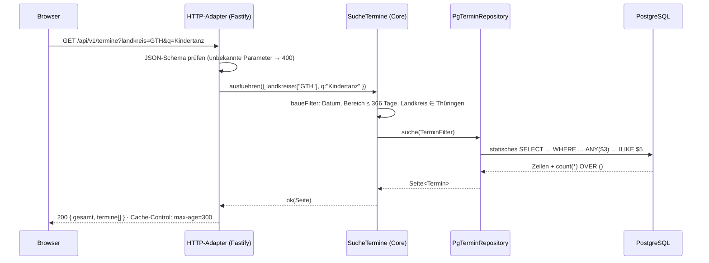
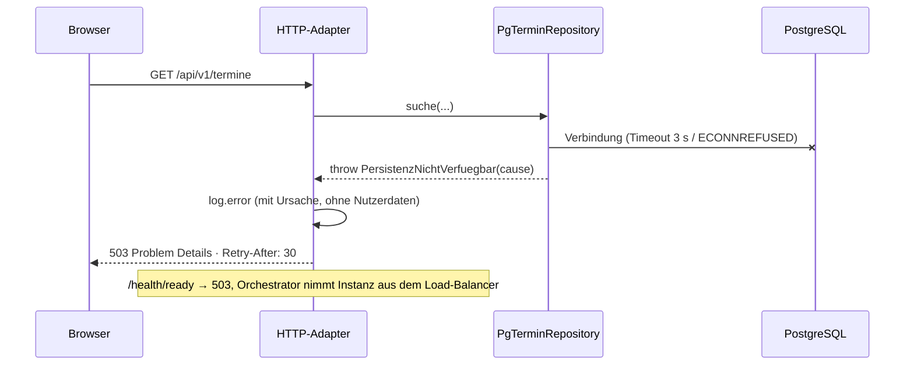
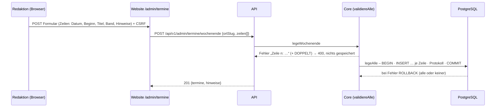
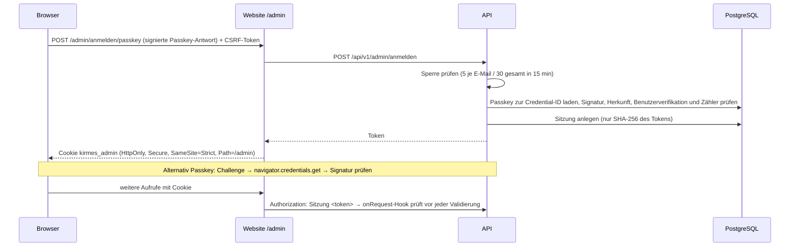

# 6. Laufzeitsicht

## 6.1 Termine suchen (Normalfall)



## 6.2 Ungültige Filter

`SucheTermine` sammelt **alle** Fehler (z. B. `BEREICH_UMGEKEHRT`, `LANDKREIS_UNBEKANNT`) und gibt
sie als `Result` zurück. Der HTTP-Adapter antwortet `400 application/problem+json` mit der
Fehlerliste; das Repository wird nicht aufgerufen.

## 6.3 Datenbank fällt aus



## 6.4 Termin anlegen (Verwaltung)

`VerwalteTermine` (Bearbeitungslink) bzw. `Redaktion` (Admin) validieren über `validiereTermin`
(harte Regeln → Fehler, Auffälligkeiten → Hinweise, z. B. `KIRMES_AUSSERHALB_HERBST`) und
speichern erst danach über den Port `TerminVerwaltung`; jede Änderung wird protokolliert.

### Kirmeswochenende (mehrere Veranstaltungen auf einmal)



Höchstens 20 Veranstaltungen je Aufruf. Kirmesgesellschaften haben denselben Ablauf über
`POST /api/v1/verwaltung/termine/wochenende`.

## 6.5 Kirmesgesellschaft trägt ihren Festplatz ein

```mermaid
sequenceDiagram
  participant K as Kirmesgesellschaft (Browser)
  participant W as Website /verwalten
  participant A as API
  participant D as PostgreSQL
  Note over K: öffnet …/verwalten#k=TOKEN<br/>(Fragment wird nie an Server gesendet)
  K->>K: Token → sessionStorage, Fragment aus URL entfernen
  K->>W: GET /verwalten/festplaetze (Authorization: Bearer TOKEN)
  W->>A: GET /api/v1/verwaltung/festplaetze (Header weitergereicht)
  A->>D: UPDATE bearbeitungslink … WHERE token_hash = sha256(TOKEN) AND nicht gesperrt
  D-->>A: Ort des Links
  A-->>K: Ort, Festplätze, Veranstaltungsorte
  K->>W: PUT {name, lat, lon}
  W->>A: PUT /api/v1/verwaltung/festplaetze
  A->>A: Koordinate in Thüringen? Name ≤ 120 Zeichen?
  A->>D: UPSERT festplatz + INSERT aenderungsprotokoll (eine Transaktion)
  Note over A,D: Ab jetzt liefert jede Terminabfrage den Festplatz mit;<br/>„Route“ führt zu den exakten Koordinaten
```

## 6.6 Anmeldung der Redaktion



Fehler werden als Problem Details ohne Interna gemeldet: 401 (nicht angemeldet / falsche Daten –
immer dieselbe Meldung), 429 mit `Retry-After` (Sperre), 403 bei fehlendem oder fremdem CSRF-Token.
