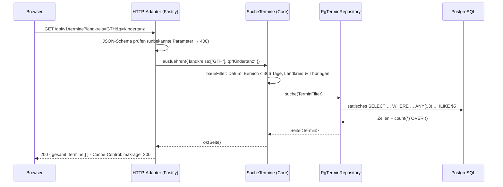
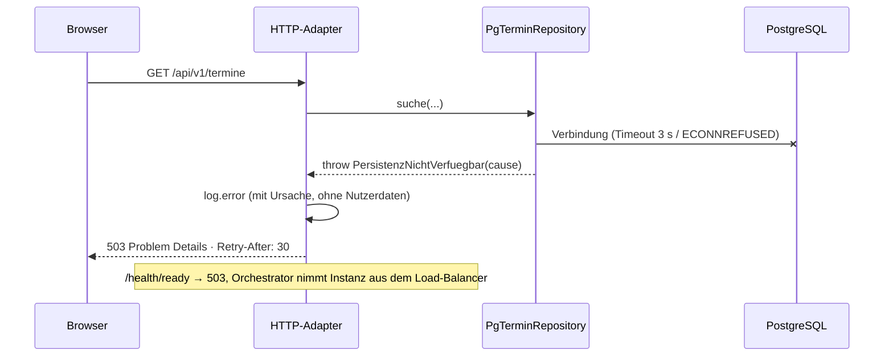

# 6. Laufzeitsicht

## 6.1 Termine suchen (Normalfall)

## 6.2 Ungültige Filter

`SucheTermine` sammelt **alle** Fehler (z. B. `BEREICH_UMGEKEHRT`, `LANDKREIS_UNBEKANNT`) und gibt
sie als `Result` zurück. Der HTTP-Adapter antwortet `400 application/problem+json` mit der
Fehlerliste; das Repository wird nicht aufgerufen.

## 6.3 Datenbank fällt aus

## 6.4 Termin anlegen (Verwaltung)

`LegeTerminAn` validiert über `validiereTermin` (harte Regeln → Fehler, Auffälligkeiten →
Hinweise, z. B. `KIRMES_AUSSERHALB_HERBST`) und speichert erst danach. Der HTTP-Endpunkt ist
noch nicht freigeschaltet, da die Authentifizierung fehlt (Kapitel 11, Issue „AuthN/AuthZ“).
