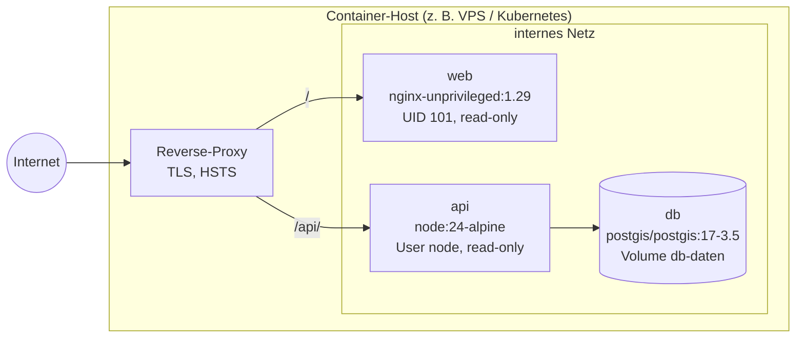

# 7. Verteilungssicht

| Knoten | Image                               | Härtung                                                            |
| ------ | ----------------------------------- | ------------------------------------------------------------------ |
| web    | `apps/web/Dockerfile`               | unprivilegierter User, Read-only-FS, `no-new-privileges`, CSP      |
| api    | `apps/api/Dockerfile` (multi-stage) | ohne Dev-Abhängigkeiten, User `node`, Read-only-FS, Healthcheck    |
| db     | `postgis/postgis:17-3.5-alpine`     | Port nur `127.0.0.1` bzw. internes Netz, Passwort aus Secret-Store |

**Lokal:** `docker compose up -d --build --wait` startet alle drei Tiers; dieselbe Topologie
nutzt der DAST-Job in CI. Auf Apple Silicon läuft das PostGIS-Image per amd64-Emulation.

**Datenhaltung:** Tägliches `pg_dump` mit Aufbewahrung von 30 Tagen (Betriebsaufgabe).
