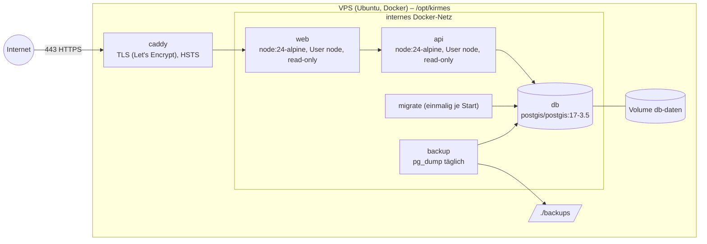

# 7. Verteilungssicht

## 7.1 Lokal (Entwicklung)

`npm run dev` startet die Datenbank als Docker-Container (`docker-compose.yml`, Dienst `db`,
Port nur auf `127.0.0.1:5432`) und API (`:3100`) sowie Website (`:4321`) direkt auf dem Rechner.
Die Daten liegen im Volume `kirmes_db-daten`.

## 7.2 Server (Produktion)

| Knoten  | Quelle                          | Härtung                                                                                                                |
| ------- | ------------------------------- | ---------------------------------------------------------------------------------------------------------------------- |
| caddy   | `deploy/Caddyfile`              | einziger öffentlicher Dienst (80/443), HSTS, automatisches TLS; setzt `X-Forwarded-For` für das Rate-Limit der Website |
| web     | `apps/web/Dockerfile`           | kein öffentlicher Port, User `node`, Read-only-FS, CSP                                                                 |
| api     | `apps/api/Dockerfile`           | kein öffentlicher Port, User `node`, Read-only-FS, Healthcheck                                                         |
| migrate | wie api                         | läuft vor der API; API startet nur nach erfolgreicher Migration                                                        |
| db      | `postgis/postgis:17-3.5-alpine` | kein Port nach außen, Passwort aus `.env` (chmod 600)                                                                  |
| backup  | wie db                          | täglicher `pg_dump`, 14 Tage Aufbewahrung                                                                              |

Die Produktions-Konfiguration ist eine Ergänzung (`docker-compose.prod.yml`) derselben Compose-Datei,
aktiviert über `COMPOSE_FILE` in der Server-`.env`. Schritt-für-Schritt-Anleitung inkl. Datenumzug:
[docs/betrieb/server-umzug.md](../betrieb/server-umzug.md).

### Rate-Limit am öffentlichen Einstieg

Die Website (`apps/web/server.mjs` + `rate-limit.mjs`) begrenzt Seitenaufrufe je Client-IP –
Standard **120 pro Minute** (`RATE_LIMIT_MAX`, `RATE_LIMIT_FENSTER_S`), statische Dateien zählen
nicht. Darüber antwortet sie mit `429` und `Retry-After`. Die Client-IP kommt aus
`X-Forwarded-For`, aber nur, wenn die Verbindung aus dem internen Netz (von Caddy) stammt. Die API
behält ihr eigenes Limit für externe Aufrufer; Meldungen an die Redaktion haben zusätzlich 5 pro
Stunde je Besucher. Im CI setzt der DAST-Job das Limit hoch, damit ZAP nicht gedrosselt wird.

### Datenbankrollen (Least Privilege)

| Rolle               | Wer                            | Rechte                                                                                                                    |
| ------------------- | ------------------------------ | ------------------------------------------------------------------------------------------------------------------------- |
| `kirmes` (Owner)    | `migrate`, `backup`, Admin-CLI | DDL, Migrationen; Passwort `POSTGRES_PASSWORD`                                                                            |
| `kirmes_app`        | `api`                          | Mitglied von `kirmes_app_rechte`; Passwort `APP_DB_PASSWORD`                                                              |
| `kirmes_app_rechte` | – (Gruppe, kein Login)         | `SELECT/INSERT/UPDATE/DELETE` auf Datentabellen, Sequenzen; kein DDL, `landkreis` nur lesen, `schema_migration` gar nicht |

Die Rechte stehen versioniert in Migration 009 (inkl. `ALTER DEFAULT PRIVILEGES` für künftige
Tabellen). Den Login `kirmes_app` legt der Migrationslauf an bzw. setzt sein Passwort neu – das
Passwort kommt nur aus der Umgebung (`.env` auf dem Server, `chmod 600`), nie aus dem Repository.
Ein Integrationstest prüft, dass die Rolle kein `DROP`, `CREATE`, `ALTER` oder `TRUNCATE` darf.

**TLS zur Datenbank:** Die Datenbank ist nur im internen Docker-Netz desselben Hosts erreichbar,
ohne Port nach außen. TLS bringt dort keinen Schutzgewinn. Für eine externe Datenbank lässt es sich
mit `DB_SSL=true` erzwingen.
