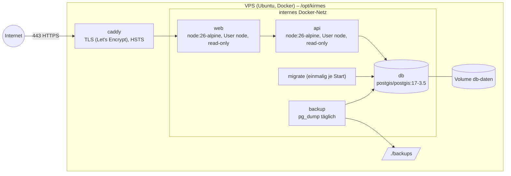

# 7. Verteilungssicht

## 7.1 Lokal: ausschließlich Docker

Auf dem Rechner ist weder Node.js noch PostgreSQL nötig. Alle Aufgaben laufen als Compose-Profile derselben `docker-compose.yml` (ADR 025):

| Befehl                                        | Services                      | Zweck                                                                              |
| --------------------------------------------- | ----------------------------- | ---------------------------------------------------------------------------------- |
| `docker compose --profile dev up`             | `db`, `dev`                   | Migrationen, API `127.0.0.1:3100` und Website `127.0.0.1:4321` mit Neuladen        |
| `docker compose run --rm check`               | `db-test`, `check`            | Lint, Typen, Build, Migrationen, Tests mit Mindestabdeckung gegen eine Wegwerf-DB  |
| `docker compose run --rm tools <befehl>`      | `db`, `tools`                 | Beliebiger Befehl, z. B. `npm run db:orte`, `npm run admin -- …`, `node scripts/…` |
| `docker compose --profile app up -d --build`  | `db`, `migrate`, `api`, `web` | Komplett wie Produktion, Website auf `127.0.0.1:8080`                              |
| `docker compose --profile mail up -d mailpit` | `mailpit`                     | Mails abfangen (`http://localhost:8025`)                                           |

Das Werkzeug-Image (`docker/werkzeug.Dockerfile`: `node:26-alpine` plus `git`, `psql`) installiert die Abhängigkeiten beim ersten Start in benannte Volumes (`werkzeug-modules`, `-api`, `-web`, `-core`) und wieder, wenn sich `package-lock.json` ändert (`scripts/docker-werkzeug.sh`). Der Projektordner ist eingehängt, Änderungen wirken sofort. Die Datenbank liegt im Volume `kirmes_db-daten` und nur auf `127.0.0.1:5432`. Die Test-Datenbank `kirmes_test` lebt im Arbeitsspeicher (`tmpfs`) und verschwindet nach dem Lauf. Integrationstests lehnen jede Datenbank ab, deren Name nicht auf `_test` endet (`apps/api/test/test-datenbank.ts`).

## 7.2 Server (Produktion)

| Knoten  | Quelle                          | Härtung                                                                                                                |
| ------- | ------------------------------- | ---------------------------------------------------------------------------------------------------------------------- |
| caddy   | `deploy/Caddyfile`              | einziger öffentlicher Dienst (80/443), HSTS, automatisches TLS; setzt `X-Forwarded-For` für das Rate-Limit der Website |
| web     | `apps/web/Dockerfile`           | kein öffentlicher Port, User `node`, Read-only-FS, CSP                                                                 |
| api     | `apps/api/Dockerfile`           | kein öffentlicher Port, User `node`, Read-only-FS, Healthcheck                                                         |
| migrate | wie api                         | läuft vor der API; API startet nur nach erfolgreicher Migration                                                        |
| db      | `postgis/postgis:17-3.5-alpine` | kein Port nach außen, Passwort aus `.env` (chmod 600)                                                                  |
| backup  | wie db                          | täglicher `pg_dump`, 14 Tage Aufbewahrung                                                                              |

Die Produktions-Konfiguration ist eine Ergänzung (`docker-compose.prod.yml`) derselben Compose-Datei,
aktiviert über `COMPOSE_FILE` in der Server-`.env`. Schritt-für-Schritt-Anleitung inkl. Datenumzug:
[docs/betrieb/server-umzug.md](../betrieb/server-umzug.md).

### Rate-Limit am öffentlichen Einstieg

Die Website (`apps/web/server.mjs` + `rate-limit.mjs`) begrenzt Seitenaufrufe je Client-IP –
Standard **120 pro Minute** (`RATE_LIMIT_MAX`, `RATE_LIMIT_FENSTER_S`), statische Dateien zählen
nicht. Darüber antwortet sie mit `429` und `Retry-After`. Die Client-IP kommt aus
`X-Forwarded-For`, aber nur, wenn die Verbindung aus dem internen Netz (von Caddy) stammt. Die API
behält ihr eigenes Limit für externe Aufrufer; Meldungen an die Redaktion haben zusätzlich 5 pro
Stunde je Besucher. Im CI setzt der DAST-Job das Limit hoch, damit ZAP nicht gedrosselt wird.

### Datenbankrollen (Least Privilege)

| Rolle               | Wer                            | Rechte                                                                                                                    |
| ------------------- | ------------------------------ | ------------------------------------------------------------------------------------------------------------------------- |
| `kirmes` (Owner)    | `migrate`, `backup`, Admin-CLI | DDL, Migrationen; Passwort `POSTGRES_PASSWORD`                                                                            |
| `kirmes_app`        | `api`                          | Mitglied von `kirmes_app_rechte`; Passwort `APP_DB_PASSWORD`                                                              |
| `kirmes_app_rechte` | – (Gruppe, kein Login)         | `SELECT/INSERT/UPDATE/DELETE` auf Datentabellen, Sequenzen; kein DDL, `landkreis` nur lesen, `schema_migration` gar nicht |

Die Rechte stehen versioniert in Migration 009 (inkl. `ALTER DEFAULT PRIVILEGES` für künftige
Tabellen). Den Login `kirmes_app` legt der Migrationslauf an bzw. setzt sein Passwort neu – das
Passwort kommt nur aus der Umgebung (`.env` auf dem Server, `chmod 600`), nie aus dem Repository.
Ein Integrationstest prüft, dass die Rolle kein `DROP`, `CREATE`, `ALTER` oder `TRUNCATE` darf.

**TLS zur Datenbank:** Die Datenbank ist nur im internen Docker-Netz desselben Hosts erreichbar,
ohne Port nach außen. TLS bringt dort keinen Schutzgewinn. Für eine externe Datenbank lässt es sich
mit `DB_SSL=true` erzwingen.

Betrieb (Backup, Restore-Test, Secret-Wechsel, Störungen): [Betriebshandbuch](../betrieb/betriebshandbuch.md).

## 7.3 Bereitstellung per GitOps

Der Server `demos-01` (Ubuntu 24.04, 2 vCPU, 3,7 GB RAM, 38 GB Platte) wird mit weiteren Projekten geteilt. Der Stack `kirmes` liegt im Repo `intershopper/server-deployments` (`stacks/kirmes/docker-compose.yml`, Secrets als `.env.sops`). Ein `gitops-agent` auf dem Server prüft alle zwei Minuten beide Repositories, entschlüsselt die Secrets kurz und startet `docker compose up -d --build`. **Veröffentlichen = Merge auf `main`.** HTTPS und Domain übernimmt der zentrale Caddy im Stack `prioliste`; `web` hängt am gemeinsamen Netz `web`, Datenbank und API bleiben im Netz `kirmes-intern`.

Regeln auf dem geteilten Server: nichts von anderen Stacks ändern, stoppen oder löschen, kein `docker system prune`, Änderungen an `stacks/prioliste/` nur anhängen und per Pull Request.

Vor jedem Update schreibt der Dienst `sicherung-vor-update` einen Dump (`vor-update-*.dump`, 30 Tage). Scheitert er, startet das Update nicht. Die Compose-Datei dieses Repos (`docker-compose.prod.yml`) beschreibt denselben Aufbau mit eigenem Caddy für einen Einzelserver (`docs/betrieb/server-umzug.md`).

## 7.4 Sicherung

Der Dienst `backup` (Image aus `apps/backup`, `postgres:17-alpine` mit `age`, `rclone`, `jq`) führt einmal täglich `pg_dump --format=custom` aus und behält 14 Tage (`SICHERUNG_TAGE`). Er schreibt `status.json` (Zeit, Datei, Größe, Anzahl, Offsite-Stand). Die API liest das Verzeichnis nur lesend (`SICHERUNGEN_VERZEICHNIS`), die Redaktion sieht den Stand und eine Warnung bei Sicherungen älter als 36 Stunden. Optional geht jeder Dump mit `age` verschlüsselt per `rclone` nach außen (`AGE_EMPFAENGER`, `OFFSITE_ZIEL`, 30 Tage); der Server kennt nur den öffentlichen Schlüssel. Der Backup-Container läuft ohne Capabilities, read-only und mit `no-new-privileges`.

## 7.5 Konfiguration

| Variable                                                                                      | Dienst              | Bedeutung                                                                      |
| --------------------------------------------------------------------------------------------- | ------------------- | ------------------------------------------------------------------------------ |
| `POSTGRES_PASSWORD`                                                                           | db, migrate, backup | Passwort des Owners `kirmes` (Server: Pflicht)                                 |
| `APP_DB_PASSWORD`                                                                             | migrate, api        | Passwort der API-Rolle `kirmes_app`, mind. 16 Zeichen                          |
| `DATABASE_URL`, `DB_SSL`                                                                      | api, migrate        | Verbindung; TLS nur bei externer Datenbank                                     |
| `WEBSITE_URL` / `APP_URL`                                                                     | api, web            | Öffentliche Adresse; Relying-Party-ID der Passkeys und Grundlage aller Links   |
| `API_URL`                                                                                     | web                 | Adresse der API (intern)                                                       |
| `API_PORT`, `HOST`, `LOG_LEVEL`                                                               | api                 | Port 3100, Bindung, Protokollstufe                                             |
| `SMTP_HOST`, `SMTP_PORT`, `SMTP_USER`, `SMTP_PASS`, `MAIL_FROM`, `MAIL_AN`, `SMTP_OHNE_TLS`   | api                 | Brevo-Zugang; ohne Angaben `mailto`; `SMTP_OHNE_TLS=nur-lokal` nur für Mailpit |
| `VAPID_PUBLIC_KEY`, `VAPID_PRIVATE_KEY`, `VAPID_KONTAKT`                                      | api                 | Push; entweder alle drei oder keine                                            |
| `RATE_LIMIT_MAX`, `RATE_LIMIT_FENSTER_S`                                                      | web                 | Seitenaufrufe je Client-IP und Fenster                                         |
| `SICHERUNGEN_VERZEICHNIS`                                                                     | api                 | Nur lesend eingebundenes Sicherungsverzeichnis                                 |
| `SICHERUNG_TAGE`, `AGE_EMPFAENGER`, `OFFSITE_ZIEL`, `OFFSITE_TAGE`, `RCLONE_CONFIG_OFFSITE_*` | backup              | Aufbewahrung und Offsite-Kopie                                                 |
| `DB_PLATFORM`, `DB_PORT`                                                                      | db                  | `linux/amd64` (PostGIS) und lokaler Port                                       |
